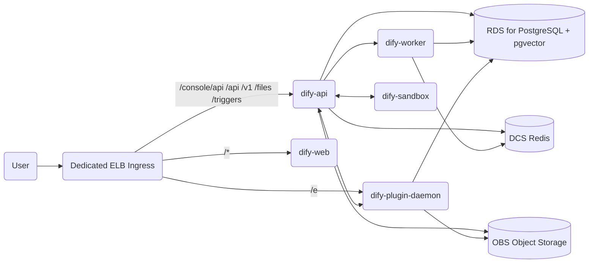

# Dify Self-Hosting Practice (Huawei Cloud)


> This repository provides a cloud-native practice for deploying Dify, a large language model application development platform, on Huawei Cloud. It includes infrastructure orchestration (Terraform) and container workload manifests (Kubernetes).
> Maintained by zhangcheng123321.

## Table of Contents

- [1. Overview](#1-overview)
- [2. Directory Structure](#2-directory-structure)
- [3. Architecture Diagram](#3-architecture-diagram)
- [4. Highlights](#4-highlights)
- [5. Cloud Services Used](#5-cloud-services-used)
- [6. Prerequisites](#6-prerequisites)
- [7. Quick Start](#7-quick-start)
- [8. Step-by-Step Deployment](#8-step-by-step-deployment)
- [9. Usage](#9-usage)
- [10. Cleanup](#10-cleanup)
- [11. Detailed Documentation](#11-detailed-documentation)
- [12. Dependencies and Acknowledgements](#12-dependencies-and-acknowledgements)
- [13. FAQ](#13-faq)
- [14. Contributing](#14-contributing)
- [15. License](#15-license)
- [16. Contact](#16-contact)
- [17. Creator / Maintainer](#17-creator--maintainer)

## 1. Overview

Dify is an open-source large language model application development platform that provides visual orchestration, RAG retrieval augmentation, Agents, workflows, and plugin capabilities. This practice deploys it on Huawei Cloud in a cloud-native manner, helping users quickly obtain a production-ready LLM application foundation within a managed Kubernetes environment.

This repository delivers two categories of orchestration artifacts:

- `infra/`: Uses Terraform and the huaweicloud Provider to define the network, database, cache, object storage, container cluster, and ingress load balancer.
- `src/manifests/`: Kubernetes manifests for each Dify component (namespace, config, secrets, workloads, services, and ingress).

## 2. Directory Structure

```
dify-on-huaweicloud/
├── infra/                 # Terraform infrastructure definitions
│   ├── main.tf            # Main resource definitions
│   ├── variables.tf       # Variables (including credential placeholders)
│   ├── outputs.tf         # Outputs (addresses, bucket name, cluster ID, etc.)
│   └── terraform.tfvars.example
├── src/manifests/         # Dify Kubernetes manifests
│   ├── 00-namespace.yaml
│   ├── 01-configmap.yaml
│   ├── 02-secrets.yaml
│   ├── 03-api.yaml
│   ├── 04-worker.yaml
│   ├── 05-web.yaml
│   ├── 06-sandbox.yaml
│   ├── 07-plugin-daemon.yaml
│   └── 08-ingress.yaml
├── docs/                  # Architecture notes and deployment guide
├── LICENSE
└── README.md
```

## 3. Architecture Diagram



See [docs/architecture.md](docs/architecture.md) for the full description.

## 4. Highlights

- **Fully managed data plane**: Database, cache, and object storage all use managed services — maintenance-free, with high availability available.
- **Containerized orchestration**: CCE hosts all Dify components, with declarative manifests that are easy to manage under version control.
- **Credential security**: All sensitive information is injected via Kubernetes Secrets and never enters the version control system.
- **Elastic scaling**: The node pool releases runtime capacity to elastic scaling and is never rolled back.
- **Unified ingress**: An Ingress automatically creates a dedicated load balancer; routing rules cover Web / API / plugins.
- **Extensible**: The plugin system and code execution sandbox are ready out of the box.

## 5. Cloud Services Used

| Service | Responsibility |
|---|---|
| Cloud Container Engine (CCE) | Runs the containers of each Dify component |
| Relational Database Service (RDS for PostgreSQL) | Primary business database and vector search (pgvector extension) |
| Distributed Cache Service (DCS Redis) | Cache and Celery message broker |
| Object Storage Service (OBS) | File uploads and plugin persistence |
| Elastic Load Balance (ELB, dedicated) | Unified ingress |
| Container Image Service (SWR) | Image registry |
| Virtual Private Cloud (VPC) / Subnet / Security Group | Network isolation and access control |

## 6. Prerequisites

- A registered Huawei Cloud account with sufficient resource quotas in the target region (default `cn-north-4`).
- Terraform (≥ 1.5) and kubectl installed locally.
- Access keys obtained and injected via environment variables (never written to files):

```bash
export HW_ACCESS_KEY="<Access Key AK>"
export HW_SECRET_KEY="<Secret Access Key SK>"
```

- A kubeconfig that can access the target CCE cluster.

## 7. Quick Start

1. Deploy infrastructure: `cd infra && terraform init && terraform apply`.
2. Record the database address, cache address, object storage bucket name, and ingress address from the outputs.
3. Fill the placeholders in `src/manifests/01-configmap.yaml` with the outputs.
4. Create Secrets via `kubectl` (credentials never enter the repository).
5. Apply all manifests: `kubectl apply -f src/manifests/`.
6. Open the ingress address, log in to the console, and connect a model provider.

See [docs/deployment-guide.md](docs/deployment-guide.md) for detailed steps.

## 8. Step-by-Step Deployment

For the complete step-by-step deployment, image preparation, placeholder backfill, credential creation, and verification flow, refer to [docs/deployment-guide.md](docs/deployment-guide.md). That document contains all commands from infrastructure creation to go-live.

## 9. Usage

1. Open the ingress address in a browser (ELB public address or a bound domain name) to enter the Dify console.
2. Log in with the initialized administrator account (default email `admin@dify.ai`, password set by `INIT_PASSWORD`, default `dify123456`; change it on first login).
3. Connect any model provider under "Model Provider" (the platform's own ModelArts / MaaS / Pangu, or any OpenAI-compatible endpoint).
4. Create an application and verify conversations, knowledge base retrieval (requires the pgvector extension provided by RDS), workflows, and plugin installation.
5. Verify health check: `curl -I http://<ingress-address>/health` should return 200.

## 10. Cleanup

When no longer needed, delete the Ingress and workloads first, then run `terraform destroy` to reclaim managed resources. The OBS bucket is configured for force deletion and is emptied on destroy. See the "Cleanup" section of the deployment guide for detailed commands.

## 11. Detailed Documentation

For architecture layering, component topology, data flow, network and security, and high-availability and sizing recommendations, read [docs/architecture.md](docs/architecture.md).

## 12. Dependencies and Acknowledgements

- **Dify**: The open-source large language model application development platform deployed by this practice ([langgenius/dify](https://github.com/langgenius/dify)); related components use its official images.
- **huaweicloud Terraform Provider**: Infrastructure is defined declaratively with Terraform.
- Thanks to the Dify open-source community and the continuous evolution of Huawei Cloud managed services, which enable this practice to run stably in a managed environment.

## 13. FAQ

**Q: Do I need to manually enable the pgvector extension on the database?**
A: It is recommended that an administrator run `CREATE EXTENSION IF NOT EXISTS vector;` before the first deployment. If the instance has it pre-installed by default, you can skip this.

**Q: Why is TLS not enabled on the cache?**
A: DCS Redis does not enforce TLS by default; the manifest connects with `REDIS_USE_SSL=false`. If encrypted transport is required, enable TLS on DCS and adjust accordingly.

**Q: How do I enable HTTPS on the ingress?**
A: Add a `tls` section and bind a certificate in `08-ingress.yaml`; the rest of the routing rules remain unchanged.

**Q: How do I scale out?**
A: The node pool releases runtime capacity by default (`ignore_changes`), so you can directly adjust the node count or enable elastic scaling; stateless components can also increase replicas.

## 14. Contributing

Improvements are welcome via tickets or merge requests. Before submitting, please ensure:

- No cloud-vendor proprietary coupling is introduced;
- No real credentials are written to any file;
- Documentation and manifests remain statically verifiable.

## 15. License

The `LICENSE` file at the repository root uses the **MIT No Attribution** license (Copyright Huawei Cloud).

## 16. Contact

This practice is maintained by zhangcheng123321. If you encounter problems or have suggestions during use, please submit them through the Huawei Cloud ticket system, and we will continue to follow up and optimize.

## 17. Creator / Maintainer

| Role | Account |
|------|--------|
| **Creator** | zhangcheng123321 |
| **Maintainer** | zhangcheng123321 |

### Appendix: Versions and Default Parameters

- Versions: Based on Dify official images `1.13.3` (api / web), `latest` (sandbox), `0.5.5-local` (plugin-daemon).
- Default region: `cn-north-4`; node flavor `c7.large.2`; node count `2`.
- Process records are not published with this practice.
