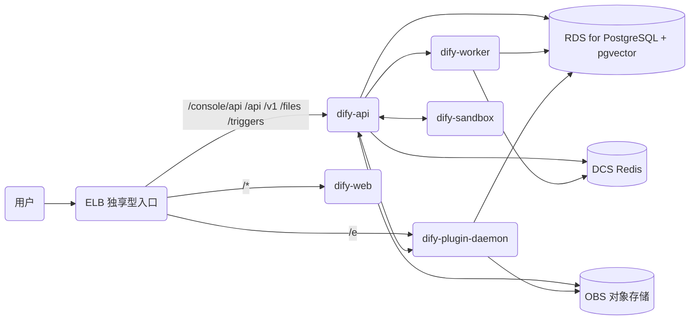

# Dify 自托管实践（华为云）


> 本仓库提供在华为云上一键落地 Dify 大语言模型应用开发平台的云原生实践，包含基础设施编排（Terraform）与容器工作负载清单（Kubernetes）。
> 由 zhangcheng123321 维护。

## 目录

- [1. 简介](#1-简介)
- [2. 目录结构](#2-目录结构)
- [3. 架构图](#3-架构图)
- [4. 方案亮点](#4-方案亮点)
- [5. 涉及云服务](#5-涉及云服务)
- [6. 前置条件](#6-前置条件)
- [7. 快速开始](#7-快速开始)
- [8. 分步部署](#8-分步部署)
- [9. 使用方法](#9-使用方法)
- [10. 清理资源](#10-清理资源)
- [11. 详细说明](#11-详细说明)
- [12. 依赖与致谢](#12-依赖与致谢)
- [13. FAQ](#13-faq)
- [14. 贡献指南](#14-贡献指南)
- [15. 许可证](#15-许可证)
- [16. 联系方式](#16-联系方式)
- [17. 创建者 / 维护者](#17-创建者--维护者)

## 1. 简介

Dify 是一款开源的大语言模型应用开发平台，提供可视化编排、RAG 检索增强、Agent、工作流与插件能力。本实践将其以云原生方式部署在华为云上，帮助用户在托管 Kubernetes 环境中快速获得一套可生产使用的大模型应用底座。

本仓库交付两类编排产物：

- `infra/`：使用 Terraform 与 huaweicloud Provider 定义网络、数据库、缓存、对象存储、容器集群与入口负载均衡。
- `src/manifests/`：Dify 各组件的 Kubernetes 清单（命名空间、配置、凭据、工作负载、服务与入口）。

## 2. 目录结构

```
dify-on-huaweicloud/
├── infra/                 # Terraform 基础设施定义
│   ├── main.tf            # 资源主定义
│   ├── variables.tf       # 变量（含凭据占位符）
│   ├── outputs.tf         # 输出（地址、桶名、集群 ID 等）
│   └── terraform.tfvars.example
├── src/manifests/         # Dify Kubernetes 清单
│   ├── 00-namespace.yaml
│   ├── 01-configmap.yaml
│   ├── 02-secrets.yaml
│   ├── 03-api.yaml
│   ├── 04-worker.yaml
│   ├── 05-web.yaml
│   ├── 06-sandbox.yaml
│   ├── 07-plugin-daemon.yaml
│   └── 08-ingress.yaml
├── docs/                  # 架构说明与部署指导
├── LICENSE
└── README.md
```

## 3. 架构图



完整说明见 [docs/architecture.md](docs/architecture.md)。

## 4. 方案亮点

- **全托管数据面**：数据库、缓存、对象存储均使用托管服务，免运维、可开启高可用。
- **容器化编排**：以 CCE 承载 Dify 全部组件，声明式清单易版本化管理。
- **凭据安全**：所有敏感信息以 Kubernetes Secret 注入，不进入版本库。
- **弹性伸缩**：节点池运行期容量释放给弹性伸缩，不被回滚。
- **统一入口**：通过 Ingress 自动创建独享型负载均衡，路由规则覆盖 Web / API / 插件。
- **件化扩展**：插件体系与代码执行沙箱齐备，开箱即用。

## 5. 涉及云服务

| 服务 | 职责 |
|---|---|
| 云容器引擎 CCE | 运行 Dify 各组件容器 |
| 云数据库 RDS for PostgreSQL | 业务主库与向量检索（pgvector 扩展） |
| 分布式缓存服务 DCS Redis | 缓存与 Celery 消息代理 |
| 对象存储服务 OBS | 文件上传与插件持久化 |
| 弹性负载均衡 ELB（独享型） | 统一入口 |
| 容器镜像服务 SWR | 镜像仓库 |
| 虚拟私有云 VPC / 子网 / 安全组 | 网络隔离与访问控制 |

## 6. 前置条件

- 已注册华为云账号，并在目标区域（默认 `cn-north-4`）具备相应资源配额。
- 本地已安装 Terraform（≥ 1.5）、kubectl。
- 已获取访问密钥，并通过环境变量注入（不写入文件）：

```bash
export HW_ACCESS_KEY="<访问密钥 AK>"
export HW_SECRET_KEY="<私密访问密钥 SK>"
```

- 具备可访问目标 CCE 集群的 kubeconfig。

## 7. 快速开始

1. 部署基础设施：`cd infra && terraform init && terraform apply`。
2. 记录输出中的数据库地址、缓存地址、对象存储桶名与入口地址。
3. 将输出回填到 `src/manifests/01-configmap.yaml` 的占位符。
4. 通过 `kubectl` 创建 Secret（凭据不入库）。
5. 应用全部清单：`kubectl apply -f src/manifests/`。
6. 访问入口地址，登录控制台并接入模型供应商。

详细步骤见 [docs/deployment-guide.md](docs/deployment-guide.md)。

## 8. 分步部署

完整的分步部署、镜像准备、占位符回填、凭据创建与验证流程，请参考 [docs/deployment-guide.md](docs/deployment-guide.md)。该文档包含从基础设施创建到应用上线的全部命令。

## 9. 使用方法

1. 浏览器访问入口地址（ELB 公网地址或已绑定域名），进入 Dify 控制台。
2. 使用初始化管理员账号登录（默认邮箱 `admin@dify.ai`，密码由 `INIT_PASSWORD` 设定，默认 `dify123456`；首次登录请修改）。
3. 在「模型供应商」中接入任意模型供应商（平台自有 ModelArts / MaaS / 盘古，或任意 OpenAI 兼容端点）。
4. 创建应用，验证对话、知识库检索（需 RDS 提供 pgvector 扩展）、工作流与插件安装。
5. 验证健康检查：`curl -I http://<入口地址>/health` 期望返回 200。

## 10. 清理资源

不再需要时，先删除 Ingress 与工作负载，再执行 `terraform destroy` 回收托管资源。OBS 桶已设置强制删除，销毁时一并清空。详细命令见部署指导「清理资源」一节。

## 11. 详细说明

架构分层、组件拓扑、数据流、网络与安全、高可用与规格建议，请阅读 [docs/architecture.md](docs/architecture.md)。

## 12. 依赖与致谢

- **Dify**：本实践部署的开源大语言模型应用开发平台（[langgenius/dify](https://github.com/langgenius/dify)），相关组件使用其官方镜像。
- **huaweicloud Terraform Provider**：基础设施以 Terraform 声明式定义。
- 感谢 Dify 开源社区与华为云托管服务的持续演进，使本实践得以在托管环境中稳定运行。

## 13. FAQ

**Q：数据库需要手动开启 pgvector 扩展吗？**
A：建议首次部署前由管理员执行 `CREATE EXTENSION IF NOT EXISTS vector;`。若实例默认已预装，可跳过。

**Q：为什么缓存没有开启 TLS？**
A：DCS Redis 默认未强制 TLS，清单中以 `REDIS_USE_SSL=false` 对接；如需加密传输，可在 DCS 开启 TLS 后相应调整。

**Q：入口如何启用 HTTPS？**
A：在 `08-ingress.yaml` 补充 tls 段并绑定证书即可，其余路由规则不变。

**Q：如何扩容？**
A：节点池默认释放运行期容量（ignore_changes），可直接调整节点数或开启弹性伸缩；无状态组件亦可提高副本数。

## 14. 贡献指南

欢迎通过工单或合并请求提出改进。提交前请确保：

- 不引入任何云厂商专有耦合；
- 不将真实凭据写入任何文件；
- 文档与清单保持可被静态校验通过。

## 15. 许可证

本仓库根目录 `LICENSE` 采用 **MIT No Attribution** 许可证（Copyright Huawei Cloud）。

## 16. 联系方式

本实践由 zhangcheng123321 维护。使用过程中遇到问题或建议，请通过华为云工单系统提交，我们将持续跟进与优化。

## 17. 创建者 / 维护者

| 角色 | 账号 |
|------|------|
| **创建者** | zhangcheng123321 |
| **维护者** | zhangcheng123321 |

### 附录：版本与默认参数

- 版本：基于 Dify 官方镜像 `1.13.3`（api / web）、`latest`（sandbox）、`0.5.5-local`（plugin-daemon）。
- 默认区域：`cn-north-4`；节点规格 `c7.large.2`；节点数 `2`。
- 过程记录不随实践对外发布。
