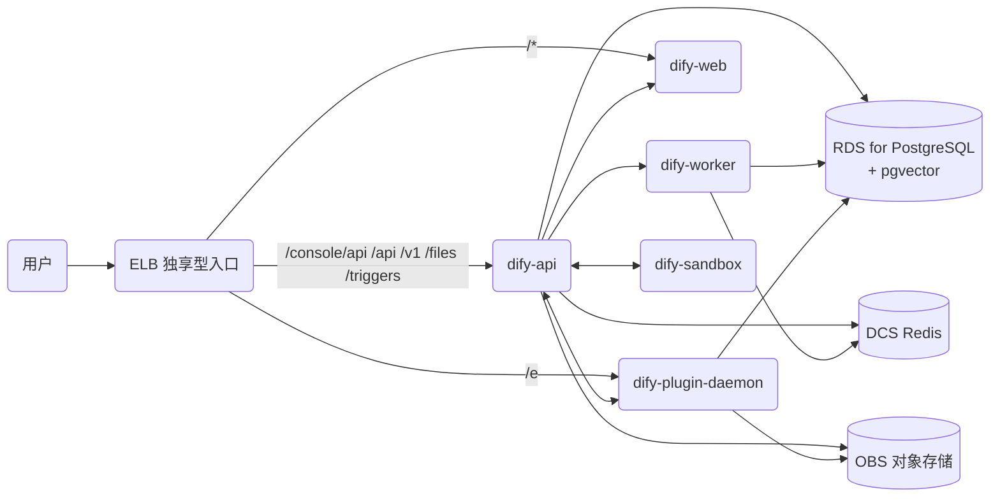

# 架构说明

> 本文档描述本实践在华为云上的部署架构。所有组件均使用华为云原生服务，不涉及任何其他云厂商产品。

## 1. 总体架构

本实践在单个虚拟私有云（VPC）内，以容器方式运行 Dify 各组件，数据面与计算面均使用托管服务：

| 层级 | 华为云服务 | 承载职责 |
|---|---|---|
| 入口 | 弹性负载均衡 ELB（独享型） | 统一对外暴露 Web / API，自动创建于集群入口 |
| 计算 | 云容器引擎 CCE（Kubernetes） | 运行 Dify 的 api / worker / web / sandbox / plugin-daemon 容器 |
| 数据库 | 云数据库 RDS for PostgreSQL（含 pgvector 扩展） | 业务主库 + 向量检索库 |
| 缓存 / 消息 | 分布式缓存服务 DCS Redis | 会话缓存、Celery 异步消息代理 |
| 对象存储 | 对象存储服务 OBS | 文件上传、插件持久化 |
| 镜像仓库 | 容器镜像服务 SWR | 存放 Dify 各组件镜像 |
| 网络 | VPC / 子网 / 安全组 | 网络隔离与访问控制 |

## 2. 组件拓扑

## 3. 数据流说明

- **请求入口**：用户访问统一入口（ELB）域名，由路由规则分发到 Web 前端或后端 API。
- **前端交互**：Web 前端通过控制台 / 应用地址调用后端 API，二者经同一入口回环。
- **异步任务**：worker 从 DCS Redis 消费 Celery 任务，执行索引构建、文档解析等后台作业。
- **代码执行**：api 调用 sandbox 执行用户代码（代码执行沙箱）。
- **插件体系**：api 与 plugin-daemon 通过内部密钥通信，插件的持久化数据存放于 OBS。
- **检索增强**：知识库向量写入 RDS for PostgreSQL 的 pgvector 扩展，实现语义检索。

## 4. 网络与安全

- **网络隔离**：所有资源置于同一 VPC；数据层（RDS / DCS）安全组仅允许来自应用安全组与 VPC 网段的 5432 / 6379 访问。
- **凭据管理**：数据库密码、Redis 密码、OBS 访问密钥、Dify `SECRET_KEY` 及组件间内部密钥一律以 Kubernetes `Secret` 注入，不进入版本库。
- **访问控制**：集群 API 通过独立 EIP 暴露，用于运维 `kubectl` 接入；业务流量走 ELB 入口。
- **节点伸缩**：节点池 `initial_node_count` 已置 `ignore_changes`，运行期弹性伸缩 / 手动调容不会被回滚。

## 5. 高可用与规格建议

- **数据库**：RDS for PostgreSQL 已开启异步高可用（`ha_replication_mode = "async"`），跨可用区部署。
- **缓存**：单节点 2G 规格可支撑中小规模；高并发场景可升级为集群版。
- **容器集群**：默认单可用区节点池（2 节点）；生产可扩展为多可用区或开启节点池弹性伸缩。
- **入口**：独享型 ELB 提供稳定公网入口；如需 HTTPS，可补tls 段并绑定证书。

## 6. 部署产物边界

- `infra/`：Terraform 定义的基础设施（网络、数据库、缓存、存储、集群、入口）。
- `src/manifests/`：Dify 各组件的 Kubernetes 清单（Namespace / ConfigMap / Secret / Deployment / Service / Ingress）。
- `docs/`：本架构说明与部署指导。
- 过程记录：架构与适配决策、门禁落实等，不随实践对外发布。
